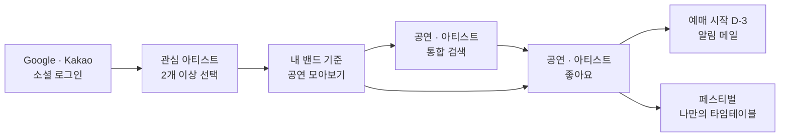
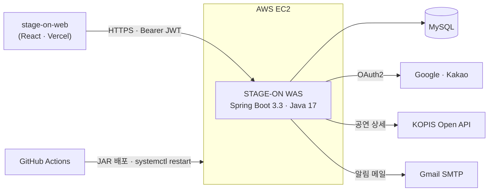

# 🎤 STAGE-ON — 좋아하는 밴드의 공연을 놓치지 않게, 페스티벌 동선은 나만의 타임테이블로

[📎 STAGE-ON 바로가기](https://stage-on-web.vercel.app)

> STAGE-ON은 국내 인디·밴드 공연과 페스티벌 정보를 한곳에 모으고, **좋아하는 아티스트를 기준으로** 공연을 찾아 주는 서비스입니다.
> 관심 아티스트를 고르면 관련 공연이 모이고, 좋아요한 공연은 **예매 시작 3일 전에 메일로 알려 주며**, 여러 무대가 동시에 열리는 페스티벌에서는 보고 싶은 무대만 골라 **나만의 타임테이블**을 만들 수 있습니다.

이 저장소는 STAGE-ON의 **백엔드(WAS)** 입니다.

[](.)
[](.)
[](.)
[](.)
[](.)
[](.)
[](.)

---

## 서비스 흐름



## 주요 기능

| 기능 | 설명 | 담당 |
| --- | --- | --- |
| 소셜 로그인 · 온보딩 | Google·Kakao OAuth2 → JWT 발급. 최초 로그인 시 관심 아티스트 선택을 마쳐야 정식 회원(GUEST → USER) | 곽동욱 |
| 좋아요 | 아티스트·공연 좋아요(합산 최소 2 · 최대 50), 다건 취소, 내 밴드·내 공연 | 곽동욱 |
| 통합 검색 | 공연명·밴드명 검색, 결과마다 좋아요 여부 표시, 최근 검색어 5개, 추천 검색어 | 곽동욱 |
| 예매일 알림 | 좋아요한 공연의 예매 시작 3일 전 아침 메일 (사용자당 1통으로 묶음) | 곽동욱 |
| 공연 정보 | KOPIS(공연예술통합전산망) Open API 연동, 아티스트·기간별 공연 조회 | 손재희 |
| 페스티벌 타임테이블 | 일자·무대별 슬롯 조회, 보고 싶은 무대만 표시하는 사용자별 커스텀 저장 | 손재희 |

---

## 백엔드 문서

코드를 기준으로 작성한 문서입니다. API 명세의 기준은 Swagger(`/swagger-ui/index.html`)이고, 여기에는 코드만 봐서는 알기 어려운 **구조 · 정책 · 결정 배경 · 문제 해결 과정**을 정리했습니다.

| 문서 | 내용 |
| --- | --- |
| [architecture.md](docs/architecture.md) | 전체 구조, 패키지 구성, 요청 처리 흐름, CI/CD, 환경 변수, 현재 구조의 한계 |
| [domain-model.md](docs/domain-model.md) | ERD, 복합 PK 좋아요 엔티티, 사용자 식별, GUEST/USER, 공연 값 컬렉션 |
| [auth.md](docs/auth.md) | OAuth2 로그인 시퀀스, provider 매핑 enum, JWT 검증 필터, 온보딩, 인증 실패 응답 |
| [like-policy.md](docs/like-policy.md) | 좋아요 개수 정책과 "작업 후 상태" 검증, 다건 취소, 온보딩 트랜잭션 |
| [search.md](docs/search.md) | 통합 검색, 좋아요 여부(쿼리 고정 2회), 최근 검색어 정책, 추천 검색어, 한계 |
| [ticketing-alert.md](docs/ticketing-alert.md) | 예매일 D-3 알림 배치 — fetch join, 사용자별 묶음, `@Async`, 실패 격리 |
| [design-decisions.md](docs/design-decisions.md) | 설계 결정(ADR) 10건 — Spotify API 검토, 토큰 전략, 에러 계약 등 *왜 그렇게 만들었는지* |
| [troubleshooting.md](docs/troubleshooting.md) | 문제 해결 8건 (증상 → 원인 규명 → 해결과 선택 근거 → 배운 점) |
| [operations.md](docs/operations.md) | 배포·로그, 시드 데이터 운영 위험, 점검 필요 항목 |
| [contribution.md](docs/contribution.md) | 곽동욱 기여 상세 — 담당 범위, 타임라인, 주요 커밋, 회고 |

### 읽는 순서

- 서비스 구조가 궁금하다 → `architecture` → `domain-model`
- 설계 의도와 문제 해결 과정이 궁금하다 → `design-decisions`, `troubleshooting`
- 인증/권한을 건드린다 → `auth`
- 좋아요·검색·알림 로직을 건드린다 → `like-policy`, `search`, `ticketing-alert`
- 배포·운영 → `operations`

---

## 아키텍처



| 구분 | 기술 |
| --- | --- |
| Language / Framework | Java 17, Spring Boot 3.3.2, Spring Web, Spring Data JPA, WebFlux(WebClient) |
| Auth / Security | Spring Security, OAuth2 Client(Google·Kakao), JJWT 0.12 (HS256) |
| Database | MySQL, Hibernate |
| Async / Batch / Mail | `@Scheduled`, `@Async`, Spring Mail(Gmail SMTP) |
| Docs | springdoc-openapi (Swagger UI) |
| Infra / CI·CD | AWS EC2, systemd, GitHub Actions |

---

## 곽동욱 — 백엔드 담당 범위와 핵심 성과

> 상세: [contribution.md](docs/contribution.md) · 전체 커밋 213개 중 163개(비병합 기준)

**담당**: 프로젝트 초기 세팅 · 인증/보안(OAuth2·JWT) · 좋아요 · 온보딩 · 통합 검색 · 최근/추천 검색어 · 예매일 알림 메일 · 전역 예외 처리 · 담당 API Swagger 명세

### 1. 다른 사용자의 데이터를 조작할 수 있던 구조(IDOR) 제거
초기 API는 `?userId=3`처럼 사용자를 요청 파라미터로 받아, 값만 바꾸면 남의 좋아요·검색 기록을 조작할 수 있었습니다. 필터가 토큰 `sub`로 `User`를 조회해 `CustomUserDetails`를 principal로 넣도록 바꾸고, 모든 API에서 `userId` 파라미터를 제거해 **서명 검증된 토큰만이 신원의 근거**가 되게 했습니다. → [troubleshooting #1](docs/troubleshooting.md#1-다른-사용자의-좋아요검색-기록을-조작할-수-있던-구조--idor)

### 2. 경계값 버그를 "작업 후 상태" 기준으로 구조적으로 해결
좋아요 최소/최대 검증 함수가 "삭제 전"과 "온보딩 저장 후" 두 시점에 쓰여, 부등호를 고칠 때마다 다른 쪽이 깨졌고 최소 개수(2개)를 고른 사용자는 온보딩 트랜잭션이 통째로 롤백돼 GUEST에 머물렀습니다. 검증을 `checkMinLikes(userId, countToDelete)` — **작업이 끝난 뒤의 개수** — 하나의 기준으로 통일해 해결했습니다. → [troubleshooting #2](docs/troubleshooting.md#2-좋아요-개수-경계값이-계속-어긋난-문제--작업-전-상태-vs-작업-후-상태)

### 3. N+1과 외부 I/O 지연을 고려한 알림 배치
예매일 D-3 대상 좋아요를 **fetch join 한 번**으로 사용자·공연과 함께 조회하고, 사용자별로 묶어 메일 1통으로 보내며, SMTP 발송은 `@Async`로 분리해 한 사용자의 지연·실패가 배치 전체를 막지 않게 했습니다. → [ticketing-alert.md](docs/ticketing-alert.md)

### 4. 에러 계약 정립
모든 `RuntimeException`이 400 + 내부 메시지로 나가던 구조를 `ErrorCode`(상태+메시지) 기반으로 재설계했습니다. 404/409/403이 의미대로 나가고, 예상하지 못한 예외는 고정 메시지 + 서버 로그로 분리됩니다. → [ADR 8](docs/design-decisions.md#8-에러-계약--errorcode-enum-한-곳에서-상태와-메시지를-정한다)

### 5. 확장 가능한 소셜 로그인 · 외부 데이터 소스 검토
Google·Kakao의 다른 응답 구조를 `OAuthAttributes` enum 전략으로 흡수해 provider 추가·제거가 상수 하나로 끝나게 했습니다. 프로젝트 초기에는 아티스트 데이터를 **Spotify Web API**로 가져오는 방안을 시도했고, 서비스에 필요한 공연 일정·밴드 소개 정보가 없는 점 등을 비교해 KOPIS + 자체 데이터 구조로 정리했습니다. → [ADR 1](docs/design-decisions.md#1-외부-데이터-소스--spotify-api를-검토하고-kopis--자체-데이터로-정했다), [ADR 4](docs/design-decisions.md#4-provider별-응답-매핑--enum-전략)

---

## 로컬 실행

```bash
git clone https://github.com/stage-on/stage_on_WAS.git
```

필요한 환경 변수(`DB_*`, `JWT_SECRET`, `GOOGLE_*`, `KAKAO_*`, `KOPIS_SERVICE_KEY`, `SMTP_*`)는 [architecture.md](docs/architecture.md#환경-변수)를 참고해 설정한 뒤 실행합니다.

```bash
./gradlew bootRun
```

API 문서: `http://localhost:8080/swagger-ui/index.html`

## 커밋 컨벤션

| 타입 | 설명 |
| --- | --- |
| `feat` | 새로운 기능 추가 및 기존 기능 수정 |
| `fix` | 버그 수정 |
| `docs` | 문서 및 주석 수정 |
| `style` | 코드 스타일 및 포맷팅 수정 |
| `refact` | 기능 변화 없는 리팩터링 |
| `test` | 테스트 코드 추가/수정 |
| `chore` | 빌드·설정 등 기타 변경 |
| `merge` | 브랜치 병합 |

---

## 🧑‍🤝‍🧑 팀 구성 (백엔드)

| BE | BE |
| :---: | :---: |
| <br>👑 [곽동욱](https://github.com/KDWorld81) 👑<br>인증·좋아요·검색·알림·예외 처리 | <br>[손재희](https://github.com/JHEEE116)<br>KOPIS·공연·타임테이블·CI/CD |
