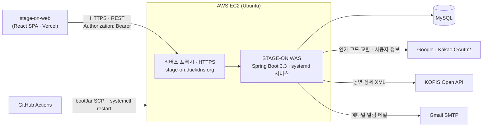
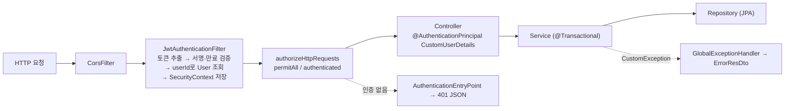

# 아키텍처

> 설계 배경과 트레이드오프: [design-decisions.md](design-decisions.md)

## 전체 구조



- 앱은 세션을 두지 않는 **stateless JWT** 구조입니다(`SessionCreationPolicy.STATELESS`). 상태는 MySQL에만 있습니다.
- 프론트는 별도 레포(Vercel)에서 배포되며, 백엔드는 CORS 허용 목록(`localhost:5173`, `stage-on-web.vercel.app`)으로만 접근을 허용합니다([CorsConfig](../src/main/java/com/stageon/stageonwas/config/CorsConfig.java)).
- HTTPS 종료는 EC2 앞단 프록시가 담당합니다(설정은 레포 밖). 앱은 `server.forward-headers-strategy: native`로 프록시가 넘겨준 `X-Forwarded-*` 헤더를 신뢰해 원래 스킴/호스트를 인식합니다.

## 패키지 구성

도메인 단위로 응집하고, 각 도메인 안에서 `api → controller → service → repository → entity / dto` 계층을 통일했습니다.

```
com.stageon.stageonwas
├── config            # CORS, Swagger(GroupedOpenApi)
├── security
│   ├── config        # SecurityFilterChain, OpenAPI Bearer 스키마
│   └── details       # CustomUserDetails (UserDetails + OAuth2User)
├── exception         # CustomException, ErrorCode, ErrorResDto, GlobalExceptionHandler
└── domain
    ├── auth          # OAuth2 로그인, JWT 발급·검증, 프로필, 최초 로그인 체크      — 곽동욱
    ├── artist        # 아티스트 좋아요·온보딩 선택(곽동욱) / 아티스트 CRUD·시드(손재희)
    ├── alonecon      # 공연 좋아요(곽동욱) / KOPIS 연동·페스티벌 타임테이블(손재희)
    ├── allsearch     # 통합 검색 · 최근 검색어 · 추천 검색어                        — 곽동욱
    ├── email         # 예매일 D-3 알림 배치 + 메일 발송                            — 곽동욱
    └── common        # 아티스트·공연을 합산하는 좋아요 개수 검증                    — 곽동욱
```

- **`api` 인터페이스 분리**: Swagger 어노테이션(`@Operation`, `@ApiResponses`, 예시 JSON)을 `XxxApi` 인터페이스에 두고 컨트롤러가 구현합니다. 컨트롤러에는 요청 처리 코드만 남아 읽기 쉬워집니다(예: [SearchApi](../src/main/java/com/stageon/stageonwas/domain/allsearch/search/api/SearchApi.java)).
- **도메인 간 공용 규칙은 `common`으로**: 좋아요 개수 제한은 "아티스트 + 공연 합산" 규칙이라 어느 한 도메인에 둘 수 없어 [LikeValidationService](../src/main/java/com/stageon/stageonwas/domain/common/service/LikeValidationService.java)로 분리했습니다([like-policy.md](like-policy.md)).

## 요청 처리 흐름



컨트롤러는 사용자 식별값을 **요청 파라미터로 받지 않고** 항상 `@AuthenticationPrincipal`에서 꺼냅니다. 초기에 `userId`를 파라미터로 받던 구조를 바꾼 과정은 [troubleshooting.md#1](troubleshooting.md#1-다른-사용자의-좋아요검색-기록을-조작할-수-있던-구조--idor)에 있습니다.

## CI/CD (`.github/workflows/deploy.yml`, 담당 손재희)

트리거는 `develop` 브랜치 push(및 수동 실행)입니다.

1. JDK 17(temurin) 세팅 → `./gradlew clean bootJar`
2. 빌드된 `STAGEON-was-0.0.1-SNAPSHOT.jar`를 SCP로 EC2 `/home/ubuntu/stage_on_WAS/app.jar`에 덮어쓰기
3. SSH로 `systemctl daemon-reload && systemctl restart stageon`

배포 확인용으로 기동 시 `### DEPLOY CHECK: APPLICATION STARTED v1 ###` 로그를 남깁니다([StageonWasApplication](../src/main/java/com/stageon/stageonwas/StageonWasApplication.java)).

## 환경 변수

값은 문서에 적지 않고 이름과 용도만 정리합니다.

| 구분 | 변수 | 용도 |
| --- | --- | --- |
| DB | `DB_HOST`, `DB_NAME`, `DB_USER`, `DB_PASSWORD` | MySQL 접속 (포트 3306 고정) |
| JWT | `JWT_SECRET` | HS256 서명 키 (`Keys.hmacShaKeyFor` → 32바이트 이상 필요) |
| Google | `GOOGLE_CLIENT_ID`, `GOOGLE_CLIENT_SECRET` | 소셜 로그인 (scope: email, profile) |
| Kakao | `KAKAO_CLIENT_ID`, `KAKAO_CLIENT_SECRET`, `KAKAO_REDIRECT_URI` | 소셜 로그인 (scope: profile_nickname, profile_image, account_email) |
| KOPIS | `KOPIS_SERVICE_KEY` | 공연예술통합전산망 Open API 키 |
| 메일 | `SMTP_USERNAME`, `SMTP_PASSWORD` | Gmail SMTP(587, STARTTLS) · 앱 비밀번호 |

## 주요 설정값

| 항목 | 값 | 위치 / 이유 |
| --- | --- | --- |
| Access Token 만료 | 6시간 (`21600000` ms) | `jwt.expiration.access-token`. Refresh Token 없이 운영하기 위해 길게 잡음([ADR 2](design-decisions.md#2-토큰-전략--access-token-단일--subject는-userid)) |
| JWT issuer | `stageon` | `jwt.issuer` |
| 좋아요 개수 | 최소 2 · 최대 50 (아티스트+공연 합산) | [LikeValidationService](../src/main/java/com/stageon/stageonwas/domain/common/service/LikeValidationService.java) |
| 최근 검색어 보관 | 사용자당 5개 | [SearchHistoryService](../src/main/java/com/stageon/stageonwas/domain/allsearch/history/service/SearchHistoryService.java) |
| 예매일 알림 | 매일 09:00, 예매 시작일 D-3 | [PerformanceAlertService](../src/main/java/com/stageon/stageonwas/domain/email/service/PerformanceAlertService.java) |
| KOPIS 호출 타임아웃 | 8초 | [KopisClient](../src/main/java/com/stageon/stageonwas/domain/alonecon/client/KopisClient.java) |
| `ddl-auto` | `update` | 스키마 자동 반영(마이그레이션 도구 없음) |
| Hibernate JDBC 타임존 | UTC | `hibernate.jdbc.time_zone` |
| CORS preflight 캐시 | 3600초 | CorsConfig |

## 현재 구조의 한계와 개선 후보

1. **단일 EC2 + `systemctl restart` 배포**: 재기동 동안 짧은 중단이 생기고, JAR 하나를 덮어쓰므로 이전 버전으로 되돌리기 어렵습니다. 빌드 산출물에 커밋 SHA를 붙여 보관하면 롤백이 쉬워집니다.
2. **CI에서 테스트를 돌리지 않음**: 워크플로가 `bootJar`만 실행하고, 테스트 코드도 컨텍스트 로드 1개뿐입니다. 좋아요 경계값처럼 실제로 버그가 났던 규칙부터 단위 테스트로 고정하는 것이 우선입니다([troubleshooting.md#2](troubleshooting.md#2-좋아요-개수-경계값이-계속-어긋난-문제--작업-전-상태-vs-작업-후-상태)).
3. **기동 시 공연 시드 데이터 재적재**: `PerformanceDataInitializer`가 기동할 때마다 공연 테이블을 TRUNCATE 후 다시 넣습니다. 배포 = 재기동이라 운영 데이터와 충돌할 수 있습니다([operations.md](operations.md#공연-시드-데이터와-재배포)).
4. **`ddl-auto: update`**: 컬럼 삭제·타입 변경은 반영되지 않아 운영 스키마는 수동 관리가 필요합니다. Flyway 등 마이그레이션 도구 도입 후보입니다.
5. **검색이 `LIKE '%키워드%'`**: 인덱스를 타지 못해 데이터가 늘면 전체 스캔이 됩니다([search.md](search.md#한계와-개선-방향)).
