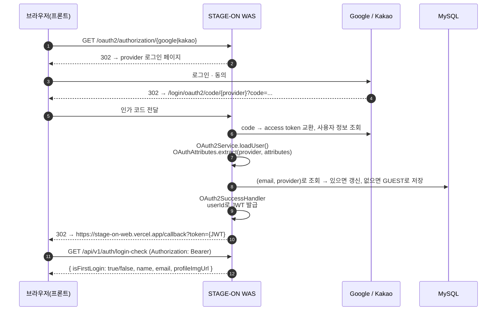
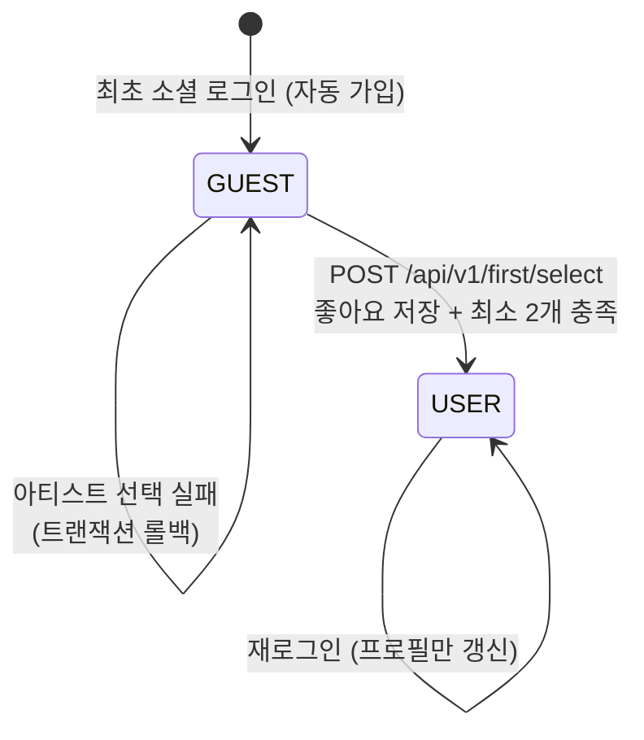

# 인증 · 인가

**담당** 곽동욱 · 설계 배경은 [ADR 2 · 토큰 전략](design-decisions.md#2-토큰-전략--access-token-단일--subject는-userid), [ADR 3 · 세션 → JWT 전환](design-decisions.md#3-소셜-로그인은-세션이-아니라-jwt로-마무리한다)

## 한눈에 보기

| 항목 | 내용 | 코드 |
| --- | --- | --- |
| 로그인 수단 | Google, Kakao (OAuth2 Authorization Code) — 일반 회원가입 없음 | [application-oauth.yml](../src/main/resources/application-oauth.yml) |
| provider별 응답 매핑 | enum 전략 `OAuthAttributes` | [OAuthAttributes](../src/main/java/com/stageon/stageonwas/domain/auth/entity/OAuthAttributes.java) |
| 사용자 저장 | 로그인 시 upsert (`(email, provider)` 기준) | [OAuth2Service](../src/main/java/com/stageon/stageonwas/domain/auth/service/OAuth2Service.java) |
| 토큰 | JWT Access Token, HS256, 6시간, `sub = userId` | [JwtProvider](../src/main/java/com/stageon/stageonwas/domain/auth/jwt/JwtProvider.java) |
| 토큰 전달 | 로그인 성공 → 프론트 `/callback?token=...` 리다이렉트 | [OAuth2SuccessHandler](../src/main/java/com/stageon/stageonwas/domain/auth/jwt/OAuth2SuccessHandler.java) |
| 요청 인증 | `Authorization: Bearer` 헤더(또는 `token` 쿼리 파라미터) | [JwtAuthenticationFilter](../src/main/java/com/stageon/stageonwas/domain/auth/jwt/JwtAuthenticationFilter.java) |
| 인증 주체 | `CustomUserDetails` (User 엔티티를 감쌈) | [CustomUserDetails](../src/main/java/com/stageon/stageonwas/security/details/CustomUserDetails.java) |
| 세션 | 사용하지 않음 (`STATELESS`) | [SecurityConfig](../src/main/java/com/stageon/stageonwas/security/config/SecurityConfig.java) |

## 로그인 흐름



- provider의 access token은 사용자 정보를 받아오는 데만 쓰고 **저장하지 않습니다**. DB에는 이름·이메일·provider·프로필 이미지·role만 남습니다.
- 리다이렉트 주소는 상수 `TARGET_URL`입니다. 개발 중 로컬 프론트(`localhost:5173/callback`)와 운영(`stage-on-web.vercel.app/callback`) 사이를 여러 번 오갔고(`1ae4d10`, `5ea4e72`, `1e89a5f`, `287aecd`, `1f28331`), 지금은 운영 주소입니다. 환경별 설정값으로 빼는 것이 개선 후보입니다([operations.md](operations.md#점검-필요-항목)).

## provider별 응답 차이 흡수 — `OAuthAttributes`

Google과 Kakao는 사용자 정보의 JSON 구조가 다릅니다.

| 필드 | Google | Kakao |
| --- | --- | --- |
| 이름 | `name` | `kakao_account.profile.nickname` |
| 이메일 | `email` | `kakao_account.email` |
| 프로필 이미지 | `picture` | `kakao_account.profile.profile_image_url` |

provider마다 `if` 분기를 늘리는 대신 **registrationId → 변환 함수**를 enum 상수로 묶었습니다(`93749cf`).

```java
GOOGLE("google", attr -> { ... }),
KAKAO("kakao",  attr -> { Map account = attr.get("kakao_account"); ... });

public static UserProfile extract(String registrationId, Map<String, Object> attributes)
```

- provider를 추가할 때 **enum 상수 하나만 추가**하면 되고, 지원하지 않는 provider는 `IllegalArgumentException`으로 즉시 드러납니다.
- 실제로 초기에 있던 Naver 로그인을 범위에서 뺄 때(`48776b6`, `93e7166`) 이 enum과 설정만 정리하면 됐습니다.

## JWT

| 항목 | 값 |
| --- | --- |
| 알고리즘 | HS256 (`Keys.hmacShaKeyFor(secret.getBytes())`) |
| `sub` | `userId` (PK) |
| `iss` | `stageon` |
| 만료 | 6시간 |
| Refresh Token | 없음 — 만료 시 재로그인 |

### 검증 필터 — `JwtAuthenticationFilter`

1. `shouldNotFilter`: `/oauth2/**`, `/error`, Swagger 경로는 필터를 건너뜁니다(`AntPathMatcher`).
2. 토큰 추출: 쿼리 파라미터 `token` → 없으면 `Authorization: Bearer ` 헤더.
3. `validateToken`: 서명·만료 검증. 실패하면 **예외를 던지지 않고** 인증 없이 다음 필터로 넘깁니다. 인증이 필요한 경로라면 뒤의 인가 단계에서 401이 됩니다.
4. `sub`(userId)로 `User`를 조회해 `CustomUserDetails`로 감싸 `SecurityContext`에 저장합니다. 탈퇴 등으로 사용자가 없으면 인증하지 않습니다(→ 401).

컨트롤러는 `@AuthenticationPrincipal CustomUserDetails`로 **엔티티 자체**를 받으므로, 서비스에서 사용자를 다시 조회하지 않고 `userDetails.getId()`를 바로 씁니다.

### 왜 `sub`가 이메일이 아니라 userId인가

초기에는 `sub`에 이메일을 넣고 필터가 문자열(email)만 principal로 넣었습니다. `de50ec7`, `9e14d8e`(2025-11-20)에서 `sub = userId`로 바꾸고 필터가 DB에서 `User`를 읽어 `CustomUserDetails`를 만들도록 바꿨습니다.

- 사용자 식별이 `(email, provider)`라서 **이메일 하나로는 사람을 유일하게 특정할 수 없습니다**. PK는 항상 유일합니다.
- 로그인할 때마다 provider 정보로 이메일이 갱신될 수 있는데, PK는 변하지 않습니다.
- 토큰에 이메일(개인정보)을 싣지 않게 됩니다. JWT payload는 서명만 될 뿐 암호화되지 않습니다.

## 온보딩 — GUEST → USER



- `POST /api/v1/first/select` 한 번에 **선택한 아티스트 좋아요 저장 + 최소 개수 검증 + role 승격**을 하나의 트랜잭션으로 묶었습니다. 하나라도 실패하면 전부 롤백되어 "좋아요는 일부 저장됐는데 GUEST로 남는" 중간 상태가 생기지 않습니다.
- 이 경계값 처리에서 실제 버그가 있었습니다 → [troubleshooting.md#2](troubleshooting.md#2-좋아요-개수-경계값이-계속-어긋난-문제--작업-전-상태-vs-작업-후-상태)

## 인가 규칙 (`SecurityConfig`)

| 경로 | 규칙 |
| --- | --- |
| Swagger (`/v3/api-docs/**`, `/swagger-ui/**` 등) | `web.ignoring()` + `permitAll` |
| `/api/v1/auth/**` | `permitAll` (단, `login-check`는 principal이 필요해 실제로는 토큰이 있어야 동작) |
| `/oauth2/**`, `/login**`, `/error` | `permitAll` |
| `/api/artists/**` | `permitAll` (손재희, `6f51103`) |
| 그 외 | `authenticated` |

CSRF·폼 로그인·로그아웃은 비활성화했습니다. 쿠키 세션이 아니라 헤더의 Bearer 토큰으로 인증하므로 CSRF 공격면이 없습니다.

## 인증 실패 응답

| 상황 | 상태 | 본문 |
| --- | --- | --- |
| 토큰 없음·만료·위조·사용자 없음 | 401 | `{"error":"Unauthorized","message":"인증이 필요합니다."}` |
| 권한 부족 | 403 | `{"error":"Forbidden","message":"접근 권한이 없습니다."}` |
| 서비스 예외 (`CustomException`) | `ErrorCode.status` | `{"status":..., "message":...}` |

- 401/403은 `SecurityConfig`의 진입점·핸들러가 **직접 JSON을 씁니다**. 필터 단계는 `@RestControllerAdvice`가 닿지 않는 곳이기 때문입니다.
- 이 두 응답과 `ErrorResDto`의 필드명이 다르고(`error` vs `status`), 만료와 위조를 구분하지 않습니다. 프론트가 "세션 만료 → 재로그인"을 안내하려면 사유 코드가 필요합니다 → [operations.md 점검 필요 항목](operations.md#점검-필요-항목)

## 알려진 한계

1. **토큰이 URL 쿼리로 전달됨**: 리다이렉트 URL(`/callback?token=`)과 필터의 `token` 파라미터 지원 때문에 토큰이 브라우저 히스토리·프록시 로그·Referer에 남을 수 있습니다. 일회용 코드 교환이나 `HttpOnly` 쿠키 전달이 대안입니다.
2. **Refresh Token·로그아웃 무효화 없음**: 탈취된 토큰은 만료(6시간)까지 유효합니다. 서버가 토큰을 통제할 수단(블랙리스트, refresh rotation)이 없습니다.
3. **같은 이메일의 다른 provider 계정**: `findByEmail` 경로에서 결과가 2건이면 예외가 납니다([domain-model.md](domain-model.md#사용자-식별은-email-provider-곽동욱)).
4. **OAuth2 인가 요청은 세션을 씁니다** `[분석]`: `STATELESS`여도 Spring의 기본 `HttpSessionOAuth2AuthorizationRequestRepository`가 로그인 왕복 동안 `state`를 세션에 둡니다. 단일 인스턴스에서는 문제없지만, 서버를 여러 대로 늘리면 쿠키 기반 저장소로 바꾸거나 sticky session이 필요합니다.
