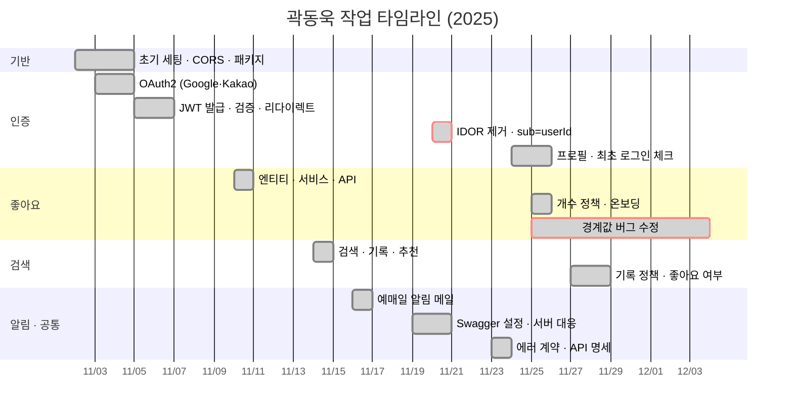

# 곽동욱 기여 상세

**역할**: 백엔드 (팀 내 백엔드 2인 중 1인) · **기간**: 2025-11-02 ~ 2025-12-09 (이후 문서 정비)
**GitHub**: [KDWorld81](https://github.com/KDWorld81)

## 요약

| 항목 | 내용 |
| --- | --- |
| 커밋 | 비병합 커밋 163개 / 전체 213개 (약 77%) |
| 담당 도메인 | 프로젝트 초기 세팅, 인증(OAuth2·JWT), 보안 설정, 좋아요(아티스트·공연), 온보딩, 통합 검색·최근 검색어·추천 검색어, 예매일 알림 메일, 전역 예외 처리, 담당 API Swagger 문서 |
| 외부 연동 | Google·Kakao OAuth2, Gmail SMTP, Spotify Web API(검토) |
| 협업 | 손재희 — KOPIS 연동, 공연·아티스트 엔티티와 시드 데이터, 페스티벌 타임테이블 커스텀, CI/CD |

> 커밋 수는 `git log --all --no-merges`의 작성자 이메일 기준입니다.

## 담당 기능 상세

### 1. 프로젝트 초기 세팅 (11-02 ~ 11-04)

- 저장소 생성, 커밋 메시지 컨벤션(README), `.gitignore`, `properties → yml` 전환(`bf19c38`~`dc69267`)
- MySQL 연결, Spring Security 초기 설정, CORS(`d5f7bb2`, `416056d`, `cd7bb59`)
- 도메인 단위 패키지 구조 확정(`0381f00`, `7dcc65b`)

### 2. 인증 · 보안 (11-03 ~ 11-25) — [auth.md](auth.md)

- 세션 기반 OAuth2 로그인으로 Google·Kakao 연동을 먼저 검증한 뒤(테스트 로그인 페이지), SPA에 맞는 **JWT 발급 + 프론트 리다이렉트** 구조로 전환([ADR 3](design-decisions.md#3-소셜-로그인은-세션이-아니라-jwt로-마무리한다))
- provider별 응답 차이를 흡수하는 `OAuthAttributes` enum 전략([ADR 4](design-decisions.md#4-provider별-응답-매핑--enum-전략)), Naver 로그인 범위 제외
- `JwtProvider`(HS256, 6시간), `JwtAuthenticationFilter`, `OAuth2SuccessHandler`
- **IDOR 구조 제거**: 모든 API의 `userId` 파라미터를 제거하고 토큰 principal로 식별([트러블슈팅 1](troubleshooting.md#1-다른-사용자의-좋아요검색-기록을-조작할-수-있던-구조--idor))
- JWT `sub`를 이메일 → userId로 변경([트러블슈팅 5](troubleshooting.md#5-jwt-subject를-이메일에서-userid로))
- 프로필 조회(이미지 포함), 최초 로그인 여부 확인(`GUEST`/`USER`) API

### 3. 좋아요 · 온보딩 (11-10 ~ 12-03) — [like-policy.md](like-policy.md)

- 복합 PK 연결 엔티티 설계(`@EmbeddedId` + `@MapsId`), 아티스트·공연 좋아요 전 계층 구현
- 아티스트+공연 합산 최소/최대 개수 정책을 공용 `LikeValidationService`로 분리
- 아티스트 다건 취소(전부 아니면 전무), 온보딩 선택을 단일 트랜잭션으로
- 경계값 버그를 "작업 후 상태" 기준으로 통일해 해결([트러블슈팅 2](troubleshooting.md#2-좋아요-개수-경계값이-계속-어긋난-문제--작업-전-상태-vs-작업-후-상태))

### 4. 검색 (11-14 ~ 12-03) — [search.md](search.md)

- 공연·아티스트 통합 검색, 결과별 좋아요 여부(쿼리 고정 2회), 상세 이동용 `mt20id`
- 최근 검색어: 중복 제거·맨 위 이동·5개 유지, 소유자 검증
- 추천 검색어: DB 공연명 무작위 5개

### 5. 예매일 알림 메일 (11-16) — [ticketing-alert.md](ticketing-alert.md)

- `@Scheduled` 배치 + fetch join 1회 조회 + 사용자별 묶음 + `@Async` 발송 + 실패 격리 로그

### 6. 예외 처리 · API 문서 (11-12 ~ 12-03)

- `RuntimeException` 일괄 400 처리를 `ErrorCode` 기반 에러 계약으로 재설계([트러블슈팅 6](troubleshooting.md#6-모든-예외가-400으로-응답되던-문제--에러-계약-정립))
- Swagger 설정, Bearer 인증 스키마, 운영·로컬 서버 주소, 담당 API 전부의 명세를 `XxxApi` 인터페이스로 작성. DTO가 바뀔 때마다 명세 동시 갱신([ADR 9](design-decisions.md#9-swagger-명세를-인터페이스로-분리한다))

### 7. 외부 데이터 소스 검토 — Spotify Web API `[진술]`

프로젝트 초기에 아티스트 정보·이미지를 **Spotify Web API**로 가져오는 방안을 시도했습니다. 연동 코드는 최종 저장소에 남아 있지 않지만, 아티스트 이미지 URL 44건이 모두 Spotify CDN(`i.scdn.co`)인 것이 그 흔적입니다. 서비스가 요구하는 공연 일정·밴드 소개·세션 정보를 Spotify가 제공하지 않는 점 등을 고려해, 공연은 KOPIS, 아티스트는 자체 데이터로 가는 구조로 정리됐습니다([ADR 1](design-decisions.md#1-외부-데이터-소스--spotify-api를-검토하고-kopis--자체-데이터로-정했다)).

### 8. 운영 대응

- 좋아요 FK 추가로 기동이 실패하던 시드 초기화 수정, 시드를 개발 프로필로 격리([트러블슈팅 3](troubleshooting.md#3-좋아요-기능-추가-후-서버가-기동되지-않던-문제--시드-초기화와-fk))
- 배포 서버 Swagger 접근 문제 대응([트러블슈팅 4](troubleshooting.md#4-배포-서버에서-swagger-접근-불가--원인을-잘못-짚었던-기록))
- 프론트 로컬/운영 환경에 맞춘 로그인 리다이렉트 대응

## 개발 타임라인

## 주요 커밋

| 날짜 | 커밋 | 내용 |
| --- | --- | --- |
| 11-03 | `93749cf` | OAuth provider 응답 매핑 enum |
| 11-03 | `c5c2cb6` | OAuth2 사용자 서비스 (upsert) |
| 11-05 | `6d73572` | 액세스 토큰 생성·검증 |
| 11-06 | `7b83cbd` | OAuth2 로그인 성공 시 JWT 발급·리다이렉트 |
| 11-10 | `9ffe544` | 좋아요 복합 PK 클래스 |
| 11-10 | `85feba0` | 좋아요 최소·최대 검증 |
| 11-12 | `c8f33e8` | 시드 초기화 FK 제약 기동 실패 수정 |
| 11-14 | `c76c841` · `06b4af8` · `325f7fe` | 검색 기록 · 검색 · 추천 서비스 |
| 11-16 | `3feb3e5` · `abdb986` | 메일 발송 서비스 · 예매일 알림 배치 |
| 11-20 | `c7130c0` · `bf8099e` · `eb659e2` · `4f76d60` | principal 기반 사용자 식별 (IDOR 제거) |
| 11-20 | `de50ec7` · `9e14d8e` | JWT `sub` = userId |
| 11-23 | `33e1046` · `e830c7f` · `35f34f6` | `ErrorCode` 기반 예외 처리 |
| 11-25 | `0161458` · `253f99a` | 온보딩 아티스트 선택 |
| 11-27 | `885d791` | 최근 검색어 중복 제거·5개 유지 |
| 11-28 | `f680e5c` · `ff5bde1` | 아티스트 다건 취소 · 검색 결과 좋아요 여부 |
| 12-03 | `6e65ef8` · `d51c25c` · `ddc640e` · `17b0ca8` | 좋아요 검증 "작업 후 상태" 기준 통일 |

## 돌아보며

- **잘한 점**: 사용자 식별을 토큰으로 일원화한 것(IDOR 제거), 에러 계약을 `ErrorCode` 한 곳으로 모은 것, 도메인을 가로지르는 규칙을 공용 서비스로 분리한 것, 알림 배치에서 N+1과 SMTP 지연을 함께 고려한 것.
- **아쉬운 점**: 좋아요 경계값을 테스트 없이 고치다 회귀가 반복됐고, Swagger 문제에서 응답 상태를 먼저 확인하지 않아 원인과 무관한 수정을 여러 번 했습니다. Refresh Token·토큰 무효화 없이 마감했습니다.
- **다음에 다르게 할 것**: 정책 숫자와 경계값은 테스트부터 작성하고, 장애 대응은 "실패한 요청의 상태 코드와 응답 주체 확인"을 첫 단계로 삼습니다. 환경별 값은 처음부터 설정으로 둡니다.
