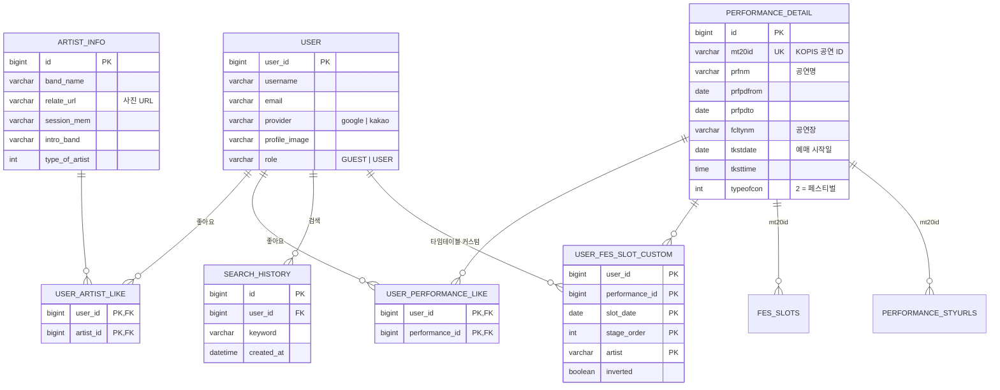

# 도메인 모델

## ERD



> `FES_SLOTS`, `PERFORMANCE_STYURLS` 외에도 `performance_relates`, `fes_days`, `fes_links`, `fes_artist_pics`가 `PerformanceDetail`의 `@ElementCollection`으로 존재합니다(아래 참고).

## 엔티티 요약

| 엔티티 | 테이블 | 담당 | 요점 |
| --- | --- | --- | --- |
| [User](../src/main/java/com/stageon/stageonwas/domain/auth/entity/User.java) | `user` | 곽동욱 | 소셜 로그인 사용자. `(email, provider)`로 식별. `role`로 온보딩 완료 여부 표현. `@DynamicUpdate` |
| [UserArtistLike](../src/main/java/com/stageon/stageonwas/domain/artist/entity/UserArtistLike.java) | `user_artist_like` | 곽동욱 | `(user_id, artist_id)` 복합 PK, `@MapsId` |
| [UserPerformanceLike](../src/main/java/com/stageon/stageonwas/domain/alonecon/entity/UserPerformanceLike.java) | `user_performance_like` | 곽동욱 | `(user_id, performance_id)` 복합 PK, `@MapsId` |
| [SearchHistory](../src/main/java/com/stageon/stageonwas/domain/allsearch/history/entity/SearchHistory.java) | `search_history` | 곽동욱 | `@CreatedDate`(JPA Auditing)로 검색 시각 자동 기록 |
| [Artist](../src/main/java/com/stageon/stageonwas/domain/artist/entity/Artist.java) | `artist_info` | 손재희 | 밴드 정보. 시드 데이터 44건 |
| [PerformanceDetail](../src/main/java/com/stageon/stageonwas/domain/alonecon/entity/PerformanceDetail.java) | `performance_detail` | 손재희 | KOPIS 공연 상세. `mt20id` 유니크 |
| [UserSlotCustom](../src/main/java/com/stageon/stageonwas/domain/alonecon/entity/UserSlotCustom.java) | `user_fes_slot_custom` | 손재희 | 사용자별 페스티벌 슬롯 커스텀 여부 |

## 설계 포인트

### 좋아요는 "대리 키 없는 연결 엔티티"다 (곽동욱)

**커밋** `9ffe544`(복합 키 클래스), `4aab85f`, `8e4f70e`

```java
@EmbeddedId
private UserArtistLikeId id;          // (userId, artistId)

@ManyToOne(fetch = FetchType.LAZY)
@MapsId("userId")                      // FK가 곧 PK의 일부
@JoinColumn(name = "user_id")
private User user;
```

- 좋아요는 "누가 무엇을" 이상의 속성이 없어 별도 `id` 컬럼 없이 **(사용자, 대상) 자체를 PK**로 삼았습니다.
- **근거** `[분석]`
  - 같은 대상을 두 번 좋아요하는 것을 **DB의 PK 제약이 막아 줍니다**. 서비스의 `existsById` 검사(`ALREADY_LIKED`)는 친절한 에러 메시지를 위한 1차 방어이고, 동시 요청이 그 검사를 동시에 통과해도 두 번째 INSERT는 PK 충돌로 실패합니다.
  - 조회·삭제가 항상 `(userId, targetId)` 단위라 `existsById(new UserArtistLikeId(...))`, `deleteById(...)`처럼 **PK로 바로 접근**합니다.
  - `@MapsId`로 연관관계와 PK 값을 한 곳에서 관리해, 엔티티 생성자에서 `id`를 연관 엔티티의 키로 채우기만 하면 됩니다.
- 복합 키 클래스는 `Serializable` 구현과 `equals/hashCode` 재정의가 필수입니다. JPA가 1차 캐시에서 키를 비교하기 때문입니다.
- **트레이드오프**: 정렬 기준이 될 "좋아요한 시각" 컬럼이 없어 "최근 좋아요 순" 정렬이 불가능합니다. 필요해지면 `created_at`을 추가해야 합니다.

### 사용자 식별은 `(email, provider)` (곽동욱)

**커밋** `a119c90`, `eedc4ef`

- 같은 이메일이라도 Google과 Kakao로 각각 로그인하면 **다른 사용자**로 저장합니다(`findUserByEmailAndProvider`).
- 로그인할 때마다 provider가 준 이름·이메일·프로필 이미지로 갱신합니다(`updateOrSaveUser`). `@DynamicUpdate`로 바뀐 컬럼만 UPDATE합니다.
- **남은 문제**: 일부 경로(`OAuth2SuccessHandler`, `UserCheckService`)는 `findByEmail`만으로 조회합니다. 같은 이메일로 두 provider에 가입한 사용자가 생기면 결과가 2건이 되어 예외가 납니다. 또 `(email, provider)`에 DB 유니크 제약이 없습니다. → [operations.md 점검 필요 항목](operations.md#점검-필요-항목)

### `role`은 권한이 아니라 "온보딩 완료 여부"다 (곽동욱)

**커밋** `f9016ee`, `7bb3c98`, `0161458`

| 값 | 의미 | 바뀌는 시점 |
| --- | --- | --- |
| `GUEST` | 소셜 로그인만 마친 신규 사용자 | 최초 저장 시(`UserProfile.toEntity`) |
| `USER` | 관심 아티스트 선택까지 마친 사용자 | `POST /api/v1/first/select` 성공 시 |

프론트는 `GET /api/v1/auth/login-check`의 `isFirstLogin`(= `role == GUEST`)으로 온보딩 화면을 띄울지 결정합니다. Spring Security 권한(`ROLE_USER`)과는 별개이며, 인가 규칙에는 쓰지 않습니다. 자세한 흐름은 [auth.md](auth.md#온보딩--guest--user).

### 공연 상세는 `mt20id`에 매달린 값 컬렉션 (손재희)

KOPIS 공연 하나에 출연진 사진(`styurls`), 예매처(`relates`), 페스티벌 일자(`days`)·무대 슬롯(`slots`)·링크·아티스트 사진이 여러 개 붙습니다. 이들은 독립 생명주기가 없어 `@ElementCollection`(값 타입)으로 두었고, 조인 컬럼은 대리 키 `id`가 아닌 **KOPIS 식별자 `mt20id`** 를 참조합니다. 무대 슬롯은 `@OrderBy("date ASC, stageOrder ASC, start ASC")`로 타임테이블 순서대로 읽힙니다.

- 검색 결과 DTO가 `styurls`(LAZY 값 컬렉션)를 공연마다 읽으므로 **검색 결과 N건 → 추가 SELECT N회**가 발생합니다([search.md](search.md#한계와-개선-방향)).
