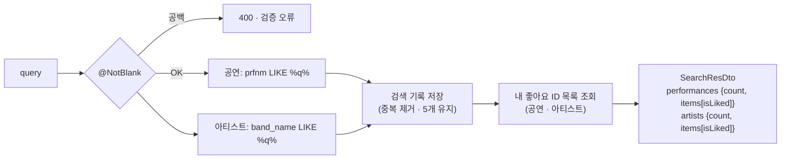

# 검색 · 최근 검색어 · 추천 검색어

**담당** 곽동욱 · 커밋 `7874512`~`e3e6561`(2025-11-14 기능 구현), `885d791`·`fe7f443`(최근 검색어 정책), `ff5bde1`(좋아요 여부), `62f40d9`(mt20id 추가)

## API

| Method | 경로 | 설명 |
| --- | --- | --- |
| `GET` | `/api/v1/search?query={키워드}` | 공연명·밴드명 통합 검색 + 검색 기록 저장 |
| `GET` | `/api/v1/search/history` | 최근 검색어 (최신순 최대 5개) |
| `DELETE` | `/api/v1/search/history/{historyId}` | 최근 검색어 삭제 (본인 것만) |
| `GET` | `/api/v1/recommend` | 추천 검색어 5개 (DB의 공연명 중 무작위) |

## 통합 검색

[SearchService](../src/main/java/com/stageon/stageonwas/domain/allsearch/search/service/SearchService.java)



- 응답은 공연/아티스트를 `{ count, items }`로 나눠 내려줍니다. 프론트가 탭별 개수를 바로 표시할 수 있습니다.
- 공연 항목에는 상세 이동에 필요한 `mt20id`(KOPIS 식별자)를 포함합니다(`62f40d9`). 처음엔 내부 PK만 내려줘서 상세 API(`/kopis/performances/detail/{mt20id}`)를 바로 호출할 수 없었습니다.
- 검색어는 `@Validated` + `@NotBlank`로 컨트롤러에서 막습니다. 공백만 있는 검색어는 기록도 남지 않습니다.

### 좋아요 여부 표시

**커밋** `ff5bde1`, `155ac7d`, `63b0441` (2025-11-28)

검색 결과 카드에 하트 상태를 그려야 해서 각 항목에 `isLiked`를 붙였습니다.

- 결과마다 "이 공연을 좋아요했는가"를 묻는 방식(결과 N건 → 쿼리 N회) 대신, **사용자의 좋아요 대상 ID 목록을 한 번씩** 가져와 메모리에서 대조합니다(`findPerformanceIdsByUserId`, `findArtistIdsByUserId` — 엔티티가 아닌 ID만 projection).
- 좋아요는 사용자당 최대 50개라 ID 목록이 작습니다. 그래서 결과 수와 무관하게 쿼리는 **고정 2회**입니다.

## 최근 검색어

[SearchHistoryService](../src/main/java/com/stageon/stageonwas/domain/allsearch/history/service/SearchHistoryService.java)

| 규칙 | 구현 |
| --- | --- |
| 같은 키워드는 하나만 | 기존 기록을 지우고 새로 저장 → **맨 위로 올라옴** |
| 사용자당 5개 유지 | 저장 후 6개가 되면 가장 오래된 1개 삭제 |
| 최신순 조회 | `findTop5ByUserOrderByCreatedAtDesc` |
| 시각 기록 | `@CreatedDate` + `@EnableJpaAuditing` |
| 삭제 권한 | 기록의 소유자가 아니면 `403 FORBIDDEN_ACCESS` |

### 정책 변경 이력 (`885d791`, 2025-11-27)

초기 구현은 "**직전** 검색어와 같으면 저장하지 않음"이었습니다.

| 검색 순서 | 초기 구현의 기록 | 문제 |
| --- | --- | --- |
| 검정치마 → 혁오 → 검정치마 | 검정치마, 혁오, 검정치마 | 같은 키워드가 목록에 두 번 |
| 6번 이상 검색 | 계속 누적 | 테이블이 무한히 커짐, 조회만 5개로 자름 |

일반적인 검색창의 최근 검색어 UX(중복 없음, 다시 검색하면 맨 위로, 개수 제한)에 맞춰 **"같은 키워드 삭제 → 저장 → 초과분 정리"** 로 바꿨습니다. 저장 단계에서 개수를 유지하므로 테이블 크기가 사용자당 5행으로 묶입니다.

### 검색과 기록 저장은 같은 트랜잭션

`SearchService.getSearchResults`가 `@Transactional`이고 기록 저장(`saveSearchHistory`)이 같은 트랜잭션에 참여합니다. 조회만 하는 API처럼 보이지만 쓰기가 일어나므로 `readOnly`를 붙이지 않았습니다.

## 추천 검색어

[RecommendService](../src/main/java/com/stageon/stageonwas/domain/allsearch/recommend/service/RecommendService.java)

검색창을 열었을 때 보여줄 키워드 5개를 DB에 있는 공연명 중에서 무작위로 고릅니다. "없는 공연을 추천하는" 일이 없도록 하드코딩 목록 대신 실제 데이터에서 뽑았습니다.

```java
long total = repository.count();
for (5회) {
    int offset = random.nextInt((int) total);
    repository.findAll(PageRequest.of(offset, 1));   // LIMIT 1 OFFSET {offset}
}
```

- `ORDER BY RAND()`는 전체 행에 난수를 매겨 정렬하므로 피했고, 개수를 센 뒤 무작위 오프셋으로 1건씩 가져옵니다.
- **트레이드오프** `[분석]`: 쿼리가 1 + 5회이고, 같은 공연이 두 번 뽑힐 수 있습니다. `OFFSET`이 커질수록 MySQL이 앞쪽 행을 읽고 버리는 비용이 듭니다. 공연 데이터가 수백 건 규모라 현재는 문제되지 않습니다. 커지면 무작위 ID 집합을 먼저 뽑아 `IN` 한 번으로 가져오고 `Set`으로 중복을 제거합니다.

## 한계와 개선 방향

| # | 한계 | 원인 | 개선 |
| --- | --- | --- | --- |
| 1 | 데이터가 늘면 검색이 느려짐 | `LIKE '%q%'`는 B-Tree 인덱스를 못 탐 → 전체 스캔 | MySQL `FULLTEXT`(ngram parser, 한국어) 또는 Elasticsearch |
| 2 | 공연 결과 N건마다 추가 SELECT | DTO가 LAZY 값 컬렉션 `styurls`(출연진)를 항목마다 읽음 → **N+1** | `@BatchSize` 또는 `default_batch_fetch_size`로 IN 묶음 조회 |
| 3 | 결과 개수 제한·페이지네이션 없음 | `findByPrfnmContaining`이 전체 반환 | `Pageable` 적용 |
| 4 | 좋아요 대조가 `List.contains` | 항목마다 선형 탐색 O(N·M) | `Set<Long>`으로 바꾸면 O(N+M) (M ≤ 50이라 현재 영향은 작음) |
| 5 | 띄어쓰기·영문 표기 차이 미대응 | "검정 치마", "The Black Skirts"는 못 찾음 | 정규화 컬럼 또는 별칭(alias) 테이블 |

공연 상세·아티스트 기준 검색 API(`/api/v1/kopis/performances/search/**`)는 KOPIS 도메인(손재희) 소관입니다.
