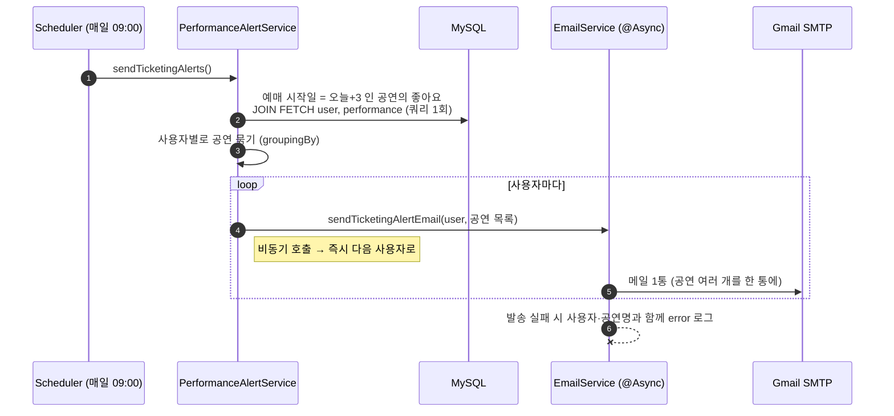

# 예매일 알림 메일 (D-3)

**담당** 곽동욱 · 커밋 `55e8e58`, `5d987e9`, `c12ca7c`, `9450ad0`, `3feb3e5`, `abdb986` (2025-11-16)

인기 공연은 예매 시작 직후 매진됩니다. 사용자가 좋아요한 공연의 **예매 시작일 3일 전 아침**에 "티켓팅 준비하세요" 메일을 보내, 좋아요를 "찜"에서 끝내지 않고 실제 행동으로 이어지게 하는 기능입니다.

## 동작



- [PerformanceAlertService](../src/main/java/com/stageon/stageonwas/domain/email/service/PerformanceAlertService.java): `@Scheduled(cron = "0 0 9 * * *")`, `@Transactional(readOnly = true)`
- [EmailService](../src/main/java/com/stageon/stageonwas/domain/email/service/EmailService.java): `@Async`, `JavaMailSender` + `SimpleMailMessage`
- [StageonWasApplication](../src/main/java/com/stageon/stageonwas/StageonWasApplication.java): `@EnableScheduling`, `@EnableAsync`

## 설계 포인트

### 1. 대상 조회는 fetch join 한 번

```java
@Query("SELECT upl FROM UserPerformanceLike upl " +
       "JOIN FETCH upl.user u JOIN FETCH upl.performance p " +
       "WHERE p.tkstdate = :tkstdate")
```

`UserPerformanceLike`의 `user`, `performance`는 모두 LAZY입니다. 좋아요 행만 가져온 뒤 메일을 만들며 `getUser()`, `getPerformance()`를 부르면 좋아요 N건마다 SELECT가 2번씩 더 나갑니다(N+1). 메일에 필요한 사용자·공연을 **한 번의 조인으로** 함께 가져왔습니다.

### 2. 사용자당 메일 1통

같은 사용자가 같은 날 예매가 열리는 공연을 여러 개 좋아요했다면, 공연마다 메일을 보내지 않고 **목록으로 묶어 1통**을 보냅니다. 스팸처럼 느껴지는 것을 줄이고 SMTP 호출 수도 사용자 수로 줄어듭니다.

`groupingBy(UserPerformanceLike::getUser)`는 `User`에 `equals/hashCode`가 없어 **객체 동일성(==)** 으로 묶습니다. 그래도 올바르게 묶이는 이유는, 하나의 트랜잭션(영속성 컨텍스트) 안에서 같은 PK의 엔티티는 **항상 같은 인스턴스**로 반환되기 때문입니다(1차 캐시의 동일성 보장) `[분석]`. 이 메서드에서 트랜잭션을 빼거나 조회를 둘로 나누면 이 전제가 깨질 수 있어 주의가 필요합니다.

### 3. 발송은 비동기로 분리

SMTP 발송은 외부 서버 왕복이라 한 통에 수백 ms~수 초가 걸립니다. 스케줄러 스레드에서 순차 발송하면 대상자가 늘수록 배치가 길어지고, 한 사용자의 SMTP 지연이 뒤 사용자 전체를 밀어냅니다.

- `@Async`로 발송을 별도 스레드 풀에 넘겨, 배치는 **대상 계산과 작업 등록만** 하고 끝납니다.
- `EmailService`가 별도 빈이라 프록시를 통해 호출되므로 `@Async`가 실제로 적용됩니다(같은 클래스 안에서 자기 호출하면 적용되지 않음).
- 메일에는 이미 로딩된 기본 필드(`username`, `email`, `prfnm`, `tkstdate`)만 씁니다. 다른 스레드로 넘어간 엔티티는 준영속 상태라 LAZY 필드를 건드리면 `LazyInitializationException`이 납니다.

### 4. 실패는 사용자 단위로 격리

발송 예외는 `EmailService`에서 잡아 **사용자 이메일·공연명·원인**과 함께 `error` 로그로 남깁니다. 한 사용자의 실패(잘못된 주소 등)가 다른 사용자 발송을 막지 않습니다.

## 알려진 한계와 개선 후보

| # | 한계 | 영향 | 개선 |
| --- | --- | --- | --- |
| 1 | **cron에 타임존 미지정** `[분석]` | `cron = "0 0 9 * * *"`와 `LocalDate.now()`는 JVM 기본 타임존을 따릅니다. EC2 Ubuntu 기본값은 UTC라 서버 설정을 바꾸지 않았다면 **한국 시간 18:00**에 발송되고, D-3 계산 기준일도 UTC 날짜가 됩니다 | `@Scheduled(zone = "Asia/Seoul")` + `LocalDate.now(ZoneId.of("Asia/Seoul"))` ([operations.md](operations.md#점검-필요-항목)) |
| 2 | 실패한 메일은 재시도 없음 | 로그로만 남고 사라짐 | 발송 이력 테이블(상태: 대기/성공/실패) + 재시도 배치 |
| 3 | 중복 발송 방지 장치 없음 | 서버를 2대로 늘리면 두 서버가 모두 보냄 | ShedLock 등 분산 락 |
| 4 | 비동기 스레드 풀이 기본 설정 | Spring Boot 기본 `applicationTaskExecutor`(코어 8, 큐 무제한) 사용 | 전용 `ThreadPoolTaskExecutor`(큐 상한·거절 정책) + Gmail 발송 한도 고려한 속도 제한 |
| 5 | 텍스트 메일 | 디자인·링크 없음 | `spring-boot-starter-thymeleaf`가 이미 의존성에 있으므로 HTML 템플릿 메일로 확장 가능 |
| 6 | 수신 거부 수단 없음 | 정보성 메일이라도 사용자 통제가 필요 | 사용자 알림 설정 컬럼 + 메일 하단 수신 거부 링크 |
